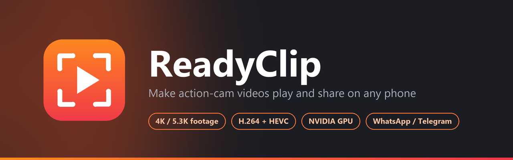
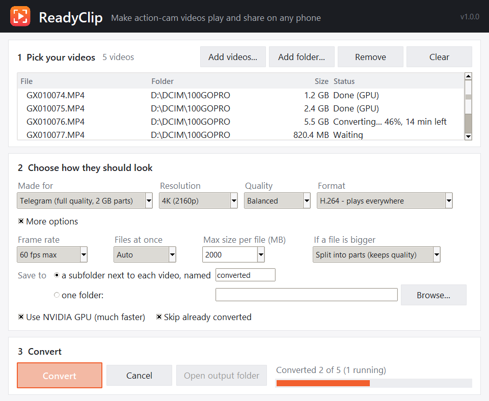

<p align="center">
  
</p>

<p align="center">
  
  
  
  
  
</p>

<p align="center">
  <a href="../../releases/latest"><b>Download for Windows</b></a>
  &nbsp;&middot;&nbsp; <a href="#features">Features</a>
  &nbsp;&middot;&nbsp; <a href="#made-for">Presets</a>
  &nbsp;&middot;&nbsp; <a href="#command-line">Command line</a>
  &nbsp;&middot;&nbsp; <a href="#python">Python</a>
</p>

---

Footage straight off a GoPro (or a similar action cam) is usually 10-bit HEVC at 4K or
5.3K and high frame rates. Many phones stutter on it, and messaging apps reject it or
crush it. **ReadyClip** batch-converts a whole SD-card folder into standard MP4s that
play everywhere. It keeps GoPro's colors and sharpness, and fits each file to wherever
you are sending it.

<p align="center">
  
</p>

## Features

| | |
| --- | --- |
| **Three steps** | Add a folder, pick what it is *made for*, press Convert. Originals are never touched |
| **Keeps the GoPro look** | Full-range BT.709 color kept on every path, 10-bit kept for HEVC, sharp multi-step downscaling |
| **Presets** | WhatsApp, Telegram, Instagram / TikTok / Shorts, YouTube, Discord, email |
| **Size limits** | Lower quality just enough to fit, or **split into parts** at full quality |
| **Fast** | Decode, resize and encode all on an NVIDIA GPU, with automatic CPU fallback |
| **Big files** | Disk space checked up front, time-left estimate, finished work kept if a later step fails |
| **Scriptable** | The same engine as a command-line tool and a Python API |

## Download

Grab `ReadyClip-vX.Y.Z-win64.zip` from the [Releases](../../releases) page, unzip it,
and double-click **ReadyClip.exe**. ffmpeg is included, so there is nothing else to install.

## Use it

1. **Pick your videos**: *Add folder...* for a whole SD-card folder, or *Add videos...*
   for individual clips.
2. **Choose how they should look**: pick what it is *Made for*, or set resolution,
   quality and format yourself. The default, *Phone-ready* (4K, Balanced, H.264), is a
   good fit for sharing.
3. **Convert**. Results go into a `converted` subfolder next to the originals (or one
   folder you choose).

Re-running on the same folder skips clips that are already converted. Settings are
remembered between runs.

### Made for

| Preset | What you get |
| --- | --- |
| Phone-ready (default) | Up to 4K, 60 fps, H.264, no size limit |
| WhatsApp video | Under 16 MB so it plays inline. Long clips drop to 30 fps and a lower resolution as needed |
| WhatsApp HD, send as document | 1080p high quality, under 2 GB (WhatsApp's document limit) |
| Telegram | Full 4K quality. Anything over 2 GB (the free-account limit) is split into parts instead of being compressed harder |
| Instagram / TikTok / Shorts | 1080p 30 fps high quality H.264. The sites re-compress uploads anyway |
| YouTube | Up to 4K, original frame rate, high quality |
| Discord free | Under 20 MB (Discord's free limit since August 2026) |
| Email attachment | Under 25 MB |

Social presets keep the video's shape. They do not crop landscape footage to vertical
9:16.

### Options

| Option | Choices |
| --- | --- |
| Resolution | Original, 4K, 2.7K, 1440p, 1080p, 720p (never upscales; 4:3 and vertical clips keep their shape) |
| Quality | Best quality, Balanced, Small files |
| Format | **H.264**: plays on every phone. **HEVC**: about half the size, plays on phones from roughly 2017 onward |
| Frame rate *(More options)* | Keep, 60 max, 30 max |
| Max size per file *(More options)* | No limit, or any size in MB |
| If a file is bigger *(More options)* | **Lower quality to fit** (default): picks the bitrate, and lowers frame rate and resolution only as far as needed. **Split into parts**: keeps full quality and cuts the video into `_part1`, `_part2`, ... files that each fit, without re-encoding them |
| Save to *(More options)* | A subfolder next to each video, or one folder for everything (same-named clips from different cards get the card folder's name added) |
| Files at once *(More options)* | Auto, 1, 2 or 3. See [Speed](#speed) |
| GPU *(More options)* | NVIDIA NVENC encoding, used automatically when available, CPU fallback otherwise |

## Quality

**Keeping the GoPro look.** GoPro records 10-bit, full-range BT.709 color. ReadyClip
keeps the full range and the color tags on every path (GPU or CPU), so blacks, highlights
and saturation match the original. HEVC output stays 10-bit, with no banding in skies or
gradients. H.264 has to be 8-bit, because phones cannot decode 10-bit H.264. Big
downscales on the GPU go in steps (halve, then a final Lanczos resize). That stays as
sharp as the CPU scaler, where a single GPU step loses fine detail.

**What it does to each file.** 4:2:0 video (what phone hardware decoders expect),
original AAC audio kept as-is, GoPro telemetry and timecode tracks dropped, creation
date kept, `faststart` so it streams and previews instantly, and the `hvc1` tag so HEVC
plays on iPhones.

**Large files.** Free disk space is checked before a long encode starts. If splitting
fails, the converted file is kept instead of thrown away. In split mode, an existing
full-size output is cut into parts directly without encoding again. The window shows
the time left per file, and "Finishing..." while a big file is written out.

## Speed

With an NVIDIA GPU, decoding, resizing and encoding all stay on the GPU (about 1.8x
faster than resizing on the CPU in testing). If a file cannot be processed that way,
ReadyClip retries with CPU resizing, then fully on the CPU.

"Files at once" converts several files in parallel. **Auto** only does that when free
GPU memory fits every job. One job needs roughly 2.4 GB for 4K sources and 2.9 GB for
5.3K, and overfilling GPU memory made conversions 2-16x slower in testing. On a 6 GB
card Auto usually picks 1. Cards with 8 GB or more get 2 or 3.

## Command line

`readyclip-cli.exe` (in the zip) or `python -m readyclip` with arguments:

```
readyclip-cli D:\DCIM\100GOPRO                         # convert a folder with saved defaults
readyclip-cli clip1.MP4 clip2.MP4 --res 1080 --fps 30
readyclip-cli D:\DCIM -r --codec hevc --quality small  # include subfolders
readyclip-cli D:\DCIM --preset whatsapp --out-dir D:\ForWhatsApp
readyclip-cli big.MP4 --preset telegram                # full quality, parts under 2 GB
readyclip-cli --res 1080 --codec hevc --save           # change the defaults the GUI also uses
readyclip-cli --show-config
```

Flags: `--preset {phone,whatsapp,whatsapp_doc,telegram,social,youtube,discord,email}`,
`--res {0,720,1080,1440,1520,2160}`, `--quality {high,balanced,small}`,
`--codec {h264,hevc}`, `--fps {0,30,60}`, `--max-size MB`, `--split` / `--shrink`,
`--gpu` / `--cpu`, `--jobs {0,1,2,3}`, `--out NAME`, `--out-dir FOLDER`,
`--overwrite`, `-r`, `--save`, `--show-config`. Flags given after a preset override it.

## Python

```python
from readyclip import Settings, apply_preset, collect_videos, convert_many

files = collect_videos([r"D:\DCIM\100GOPRO"])
settings = apply_preset(Settings(), "whatsapp")
results = convert_many(files, settings,
                       on_progress=lambda i, f: print(files[i].name, f"{f:.0%}"))
for r in results:
    print(r.source.name, r.status, r.output, r.message)
```

`convert_many` callbacks receive the file's index first and may run on worker threads.
`convert_file(path, settings, on_progress, cancel)` converts one clip, and `cancel` is a
`threading.Event` you can set from another thread.

## Run from source

Needs Python 3.9+ and ffmpeg/ffprobe on PATH (or placed in the project folder).

```
python ReadyClip.pyw          # GUI
python -m readyclip --help    # CLI
pip install .                 # installs `readyclip` and `readyclip-gui` commands
```

## Releasing

Run `release.bat` (or `release.bat 1.0.1`). It checks for uncommitted changes and
duplicate tags, bumps `__version__`, commits, tags and pushes. That is the same as
pushing a tag such as `v1.0.0` by hand. The GitHub Actions workflow builds both exes with
PyInstaller, bundles ffmpeg, smoke-tests the CLI and attaches the zip to a GitHub
release. *Run workflow* on the Actions tab builds a test zip without releasing.

## Brand


The icon (a viewfinder around a play button on a sunset gradient) and the banner are
drawn in code: `python assets/make_icon.py` regenerates `readyclip.png`, `readyclip.ico`
and `banner.png` (needs Pillow). Brand colors: orange `#FF8A1E` to coral `#F0364A`, on
ink `#1B1D22`.
<br clear="left">

## License

ReadyClip is MIT licensed. The release zip bundles an ffmpeg build from
[BtbN/FFmpeg-Builds](https://github.com/BtbN/FFmpeg-Builds), which is GPL licensed
(see `FFMPEG-LICENSE.txt`, source available from that project). ReadyClip is not
affiliated with GoPro; "GoPro" is a trademark of GoPro, Inc.
